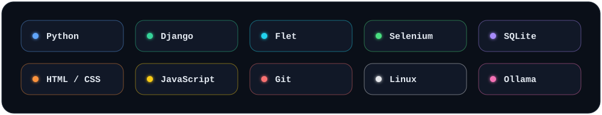

 

### ✦ About

سلام! من **محمدجواد** هستم، برنامه‌نویس پایتون.
ربات، داشبورد دسکتاپ و سایت می‌سازم و برایم مهمه که هر چیزی که می‌سازم هم درست کار کنه و هم قشنگ باشه.

### ✦ Stack

### ✦ Numbers

### ✦ Featured

| Project | What it does |
| :-- | :-- |
| **Work Logger** | Flet desktop app that tracks working time, idle time, apps and daily goals, with Excel reports |
| **Project 2** | One short line |
| **Project 3** | One short line |

